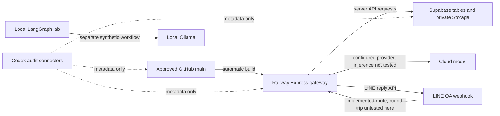

# Neurohands integration audit — 10 November 2026

This is a dated inspection and continuation plan. It is not approval to merge
PR #13, apply migrations, change secrets, buy services, or activate new features.
Customer messages and documents were not read. No model inference or training
was performed. Evidence timestamps are UTC; user-facing dates use Asia/Bangkok.

## Current state

| Area | Observed evidence | Limit of that evidence |
| --- | --- | --- |
| GitHub | PRs [19](https://github.com/tanadanaitan-prog/neurohands-ai-agent/pull/19) and [20](https://github.com/tanadanaitan-prog/neurohands-ai-agent/pull/20) merged under separate founder approvals. Main is `889c8a4dd86c5dd615e60bc3f0a9e5b428851acf`. | Only guard repairs were approved for main. |
| Candidate | PR #13 application/test revision `a5693f9efdff63bfffb46cd805e519c583258da1`: 539/539 tests, syntax/contracts, web build and offline lab passed. [GitHub isolation check passed](https://github.com/tanadanaitan-prog/neurohands-ai-agent/actions/runs/42779129776/job/129704648842). | The full suite is local evidence; GitHub runs the bounded isolation probe. PR #13 remains open. |
| Local folder | The original working branch was safely fast-forwarded during repair. Two modified tracked files and 98 untracked files were hash-checked and preserved. All 195 tracked files at the tested code revision were present and hashed. | These counts describe that revision, before this documentation update. Presence/hashes do not prove behavior. Unfinished work is not in GitHub. |
| Railway | Project `9a97651f-2fdf-4537-bce4-d6a7ad877720`, production service `neurohands-ai-agent`, source repository `tanadanaitan-prog/neurohands-ai-agent`, branch `main`. Deployment `f686a18d-530d-42d7-8902-234253a3cfac` succeeded. | Main merges automatically trigger Railway: the approved guard merge also rebuilt the existing application. PR #13's application was not deployed. |
| Public gateway | Both recorded domains return HTTP 200 from `/version` with main `889c8a4`, and `/ready` returns `{"ready":true}`. | Readiness checks configuration/database/storage prerequisites; it does not call an LLM or prove LINE delivery. |
| Supabase | Project `darxiaearohhnxiwhcbs`, organization plan `free`, status `ACTIVE_HEALTHY`; 25 public tables with RLS enabled; four recorded migrations. Required inspected Phase 1 columns exist. The founder confirmed Railway's saved `SUPABASE_URL` matches on 10 November. | The URL match is a manual configuration confirmation; this audit did not read Railway secrets or test live model answers. |
| Storage | `neurohands-docs` is private, configured file limit 10,485,760 bytes (10 MiB), with document MIME restrictions. | This is the live configured ceiling, not a verified maximum for every plan. Large-upload activation remains held. |
| Local model lab | Ollama port 11434 refused the read-only metadata connection. The port 2024 check timed out outside the sandbox. | Ollama was unreachable at that observation; a timeout does not prove LangGraph is absent. Neither service was started or reconfigured. |

The two verified gateway domains are
`neurohands-ai-agent-production.up.railway.app` and
`neurohands-ai-agent-production-dd32.up.railway.app`.
Railway has one replica and no mounted persistent volumes. Its configured build
command is `npm run check && npm test && npm run build`, start command is
`npm start`, and readiness path is `/ready`. Its GitHub `checkSuites` switch is
false. Do not assume GitHub CI blocks an automatic main deployment.

One hour of Railway metrics reported average memory usage 0.07673533691803278 GB
and configured CPU/memory limits of 8 and 8 GB respectively. These are observed
metrics/configuration, not a free allowance, spending guarantee, or capacity test.

## Platform and code map

| Platform/layer | Language and source | Actual responsibility |
| --- | --- | --- |
| GitHub | JavaScript, ES modules, HTML/CSS, SQL, YAML; [package scripts](../package.json) | Versioned source and reviewed changes; [isolation workflow](../.github/workflows/untrusted-pr.yml). |
| Railway gateway | Node 24 / CommonJS Express, [server](../src/server.js) | Verify LINE signatures, route roles, call permitted tools/providers, reply, record evidence, serve signed upload endpoints. |
| Supabase | PostgreSQL SQL [migrations](../supabase/migrations), REST/Storage clients in server and [repository](../src/platform/repository.js) | Client-scoped records, encrypted webhook queue, runs/tool calls, memory/tasks and private documents. |
| Website | HTML/CSS/browser ES modules, [web source](../web/src), [Studio router](../src/platform/router.js) | Gated workspace/department/team/agent definitions. `runtimeConnected:false`; publishing a definition does not deploy an agent. |
| Local LangGraph lab | JavaScript ES modules, [graph configuration](../langgraph.json), [team](../src/agent/team.mjs), [workflow](../src/agent/workflow.mjs) | Synthetic role/tool tests and fixed one-, two- and five-role workflows. Separate from production LINE/customer data. |
| Observability | Optional [trace runtime](../src/lib/optional-trace-runtime.js); local LangSmith scripts | Trace handling and synthetic local trace commands exist. This audit did not verify a live LangSmith connection. Railway tracing is disabled. |
| MCP/connectors | Codex's GitHub, Supabase and Railway tools | Enabled this audit. They are not automatically installed as tools for Jarvis or Aria. No general MCP runtime was found in the inspected application/script/package paths. |

The Supabase edge in this diagram is the implemented architecture. Supabase's
API tool confirms `https://darxiaearohhnxiwhcbs.supabase.co`. On 10 November,
the founder confirmed Railway's saved `SUPABASE_URL` is identical. This is a
manual comparison, not a secret read or model test. Opening its bare `/` may
return an invalid-path JSON response; it is not the dashboard. Keep the base URL
in the variable: the application supplies API paths.
[Official API routing documentation](https://supabase.com/docs/guides/api).

## Database reconciliation

Observed remote migration history matches these local versions:

- `20260907123525` — Phase 1 gateway recovery.
- `20260907130303` — webhook inbox.
- `20260908142249` — model metrics.
- `20260909155146` — Jarvis operator runs.

These six versions exist in the PR #13 checkout but are absent from remote history:

| Version | Purpose | Required treatment |
| --- | --- | --- |
| `20260907112335` | Workspace foundation | Phase 2 hold; do not apply with a Phase 1 repair. |
| `20260917103000` | Resumable upload metadata | Review bucket/quota/resume/cleanup acceptance before activation. |
| `20260917174745` | Durable allowance admission | Isolated database and verified allowance review first. |
| `20260918022110` | Agent API request idempotency | Review before deploying the candidate API path that requires its RPCs. |
| `20260918161500` | Deployment approvals | Review authority and migration prerequisites separately. |
| `20260918163000` | Allowance continuity | Review alongside admission lifecycle and recovery evidence. |

Absence from migration history is not proof that no manual DDL ever occurred.
Do not blanket-push migrations. [Existing database deployment instructions](../supabase/README.md).

The security advisor returned 25 informational `rls_enabled_no_policy` findings.
Metadata checks found no SELECT/INSERT/UPDATE/DELETE grants for `anon` or
`authenticated` on public tables, and no browser execution grants on public
security-definer functions. This is consistent with the documented server-only
access design. It is not a reason to add broad browser policies. Health advisories
were empty; 13 unused-index findings were informational and left unchanged.
Server-side tenant isolation still needs the separate customer acceptance test.
[Advisor interpretation](https://supabase.com/docs/guides/observability/advisors).

## Memory, training and unfinished folders

Gateway memory is stored context: client memory/tasks, confirmed Jarvis notes,
delivered operator history, and document/run/tool evidence. Local graph memory and
the named-workflow `handoffs.jsonl` are separate synthetic state. This audit did
not train or fine-tune model weights, add autonomous research, or connect new MCP
tools. [Jarvis context](../src/lib/jarvis-context.js), [local workflow](../src/agent/workflow.mjs).

The original folder's untracked `engineering/architect-v3` contains 92 files,
including preserved/reviewed 42-file kits and dated evidence. Its September report
records 17 checker tests but blocked host read isolation, no architect model run,
and 32 behavioral scenarios not run. `model-lab` contains four specification files,
including 12 proposed cases; it is not a working training harness. These historical
records were inspected, not rerun or promoted to deployed code. Sineid material
remains on hold and was not inspected.

## Next work, in order

| Priority | Owner/action | Acceptance evidence |
| --- | --- | --- |
| 1 | Completed by founder: non-secret Supabase URL comparison. | Founder confirmed the saved value is identical on 10 November; no configuration change was required. |
| 2 | Backend/Database: review PR #13 application/schema dependencies in isolation. | Explicit applied/unapplied inventory, required RPC checks and reviewed migration sequence; no blanket push. |
| 3 | ENG/founder: verify provider allowance and intended deployment controls before live tests. | Current approved allowance established before any model request; confirm the intended automatic-deployment policy. This does not approve a release. |
| 4 | QA & Safety: after allowance verification, complete the approved second-account KNC/Aria pilot checklist. | Correct document answer, permitted successful `read_document`, tenant-denial test, matching persisted run/tool/delivery evidence. Use the team's reviewed checklist; do not substitute unreviewed test scripts. Final release still requires explicit founder approval. |
| 5 | Platform team: connect reviewed definitions to execution and add scoped MCP skills only after the pilot. | Tool permissions, retries/idempotency, per-client isolation, memory persistence and human-reviewed outcome tests; scale 1 → 2 → 5 before larger organizations. |

The strict release gate currently fails: `releaseAccepted:false`, four controls
passed and eight partial. Six deterministic controls are bound; GitHub's newly
passing isolation run does not automatically update that release register.
Record/review that evidence before changing control acceptance. A healthy HTTP
endpoint, a test count, or a model reply alone cannot satisfy the pilot.

## Continue safely

Read this audit and [CONTINUATION_STATE.json](CONTINUATION_STATE.json), then inspect
current Git/remote state before using their dated conclusions. Preserve dirty
files; work on a `codex/` branch. Plan an exact success criterion, research the
relevant platform contract, implement only authorized changes, measure and test,
obtain independent review, perform only approved release actions, and update the
checkpoint with the new evidence and next owner. Never put keys/customer content
in the checkpoint. This is a manual handoff protocol, not automatic enforcement.

Local raw evidence is retained under `outputs/repo-integrity-20261110/`:
`final-validated/results.json`, `final-validated/ci.json`, `platform-audit/metadata.json`,
`public-endpoints.json`, `migration-inventory.json`, `tracked-source-manifest.json`,
`local-services-verified.json` and `release-gate.log` (the last six under
`platform-audit/`). Output folders are intentionally ignored by Git. Preserve this
evidence when handing off; the summaries alone do not replace raw results.
