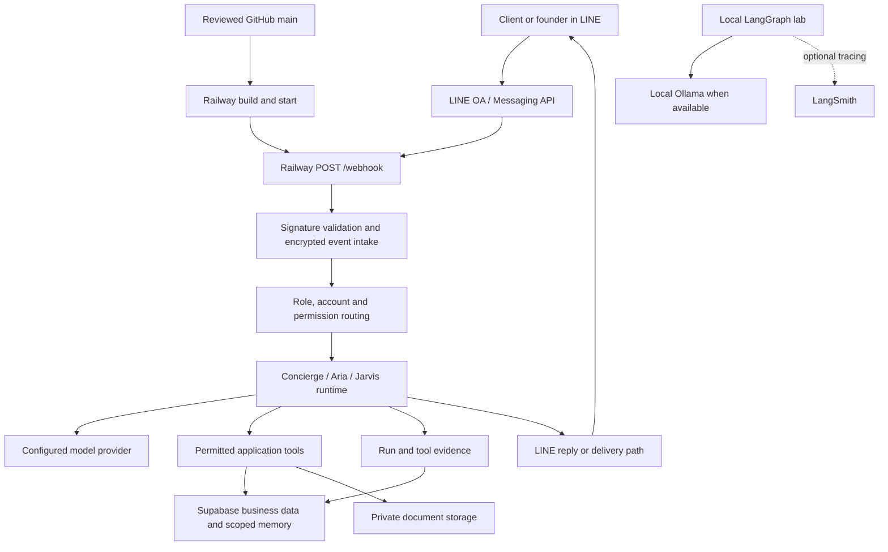

# Project structure and continuation

Reviewed 10 November 2026. Organization baseline: `52bfc191093dde6064b1827aa28421ca37160c6b`.
This change organizes the candidate branch; it does not deploy PR #13.

## Start and reading order

Read the [root README](../../README.md), [documentation index](../README.md),
[current audit](../INTEGRATION_AUDIT_2026-11-10.md), then the
[continuation state](../CONTINUATION_STATE.json).
The [structure catalog](../../config/project-structure.v1.json) supplies an
ordered inventory without renaming paths used by the application or CI.

| Order | Location | Contents and language | Operational role |
| --- | --- | --- | --- |
| 1 | `README.md`, `docs/` | Markdown guides; JSON continuation state | Human navigation, plans, dated evidence and owners |
| 2 | `config/`, root manifests | JSON; environment-name examples | Contracts, release registers, dependencies and lab entry points |
| 3 | `src/server.js`, `src/lib/` | JavaScript, Node 24, Express | LINE gateway, tool permissions, provider calls and persistence |
| 3 | `src/agent/` | JavaScript ESM, LangGraph | Isolated local agent and team experiments |
| 3 | `src/platform/` | JavaScript | Studio definition storage and routes; runtime connection is not implemented |
| 4 | `web/`, `assets/` | HTML, CSS, JavaScript, PNG | Browser UI and LINE menu assets |
| 5 | `supabase/` | SQL migrations; JSON metadata catalog | Database contracts and dated cloud schema observations |
| 6 | `infrastructure/railway/`, `.github/` | JSON observation; YAML CI | Deployment map and isolation workflow |
| 7 | `scripts/` | Existing JS tools; new Python checker | Maintenance and bounded local verification |
| 8 | `test/`, `scripts/tests/` | Node tests and Python unittest | Regression checks; results do not imply live acceptance |
| 9 | `artifacts/`, `reviews/` | Dated JSON/JSONL evidence | Measured runs and reviews, not current service status |
| 10 | `docs/originals/`, recovery manifests | Preserved recovery sources | Historical provenance; not runnable replacements |

The three lab guides moved to `docs/guides/lab/`; their previous files preserve
section headings and link to the new locations. Registered evidence, migrations,
runtime imports and original recovery sources keep their paths.

Private `.env*` files, dependencies, generated builds and `outputs/` are not
part of the tracked catalog. The user's unfinished `engineering/`, `model-lab/`
and held Sineid files remain outside this change. Their absence from the index
does not mean they were deleted or accepted.

## Application and platform flow



This is an architecture map, not proof that every path currently works.
The separate Studio UI stores agent definitions; the inspected router reports
`runtimeConnected: false`. Local team tests do not activate production teams.
The inspected app has no generic MCP client integration. Connected Codex tools
are engineering access, not tools automatically available to Jarvis.
See the [audit](../INTEGRATION_AUDIT_2026-11-10.md) and actual
[router](../../src/platform/router.js), [gateway](../../src/server.js),
[local graph](../../src/agent/graph.mjs).

## Database map

The [observed schema catalog](../../supabase/catalog/observed-public-schema.json)
contains **25 public tables, 230 columns and 24 foreign-key constraints**, from
metadata-only queries on 10 November. No customer rows, defaults, secrets or
stored files were exported. Domain groupings are a documentation design:

| Group | Tables |
| --- | --- |
| Identity and access | client_accounts, clients, agent_registry, client_agent_bindings, activation_codes, staff_activations |
| Business operations | glass_types, edging_services, orders, production_queue, scores, settings |
| Agent work and evidence | agent_runs, tool_calls, agent_memory, agent_tasks, jarvis_audit_log, jarvis_notes, jarvis_checklist |
| Messaging and support | line_webhook_events, messages, bot_feedback, support_cases, escalations |
| Documents | client_documents; private neurohands-docs bucket |

All tables remain in `public`. Changing schemas/table names would change
application queries and requires a separate migration. Four migration versions
are recorded remotely; six candidate versions are absent from that history,
including the separate Phase 2 workspace migration. Do not apply all pending
files as one operation. The current bucket limit is **10 MiB**, not 100 GB.
See the [migration inventory](../INTEGRATION_AUDIT_2026-11-10.md#database-reconciliation)
and [database notes](../../supabase/README.md).

Supabase confirms the base URL
`https://darxiaearohhnxiwhcbs.supabase.co`; the founder confirmed on 10 November
that Railway's saved `SUPABASE_URL` is identical. This is a manual configuration
comparison, not a credential or model-quality test. The browser's invalid-path
response at `/` does not require changing this variable.
[Supabase documents the data API at /rest/v1/](https://supabase.com/docs/guides/api).

## Railway configuration map

The [observed production metadata](../../infrastructure/railway/observed-production.json)
records the existing service, main-branch source, build/start commands, readiness
path, public domains, variable names and deployment revision. It contains no
variable values and is not a file Railway applies.

Dashboard configuration remains the service's recorded control surface.
`railway.json` stays as the historical reference. Current Railway documentation
deprecates that legacy format with a 1 December 2026 cutoff for existing users.
A later reviewed migration can import current settings, preserve secret values
and preview the plan. No migration or apply command ran in this organization
change. [Railway configuration documentation](https://docs.railway.com/config-as-code),
[Infrastructure as Code](https://docs.railway.com/infrastructure-as-code).

## Why these languages and structure

This is our engineering decision, not a platform requirement:

- Keep JavaScript/ESM, SQL and the existing frontend where they already run.
  Rewriting the application to Python adds migration risk without solving
  organization.
- Use Python's standard library for the offline inventory, paths and JSON.
  No dependency installation, paid service or new daemon is needed.
  [Python pathlib reference](https://docs.python.org/3.14/library/pathlib.html).
- Use JSON for machine-readable maps and Markdown for human explanations.
  Preserve relative links and section headings so old review links still work.
  [GitHub README and relative-link guidance](https://docs.github.com/en/repositories/managing-your-repositorys-settings-and-features/customizing-your-repository/about-readmes).
- Preserve timestamped SQL migration filenames and order. Organize their
  purpose in the catalog rather than renumbering history.
  [Supabase migration guidance](https://supabase.com/docs/guides/local-development/database-migrations).

## Check and continue

From the checkout root, with Python 3.11 or newer:

```text
python -B -m unittest discover -s scripts/tests -p test_project_structure.py -v
python -B scripts/check_project_structure.py --output outputs/project-structure.json
```

The checker inventories Git-indexed paths. New intended files must be staged
before they enter the inventory; stage exact paths only. It checks classification,
existence, common Markdown links/anchors, JSON readability, migration version
names and forwarding pages. Protected paths are existence guards, not immutable
content checks. A separate Git baseline comparison verifies runtime/provenance
preservation. The checker does not contact cloud services or validate credentials,
LLM quality, foreign-key semantics or production behavior.

Use this loop for each bounded task:

1. **Plan:** record objective, exact revision, permitted paths, owner and acceptance
   evidence in the continuation record.
2. **Research and compare:** inspect the relevant source and official docs;
   separate observed state, design proposals and unknowns.
3. **Implement:** make one reviewed change on an isolated branch; preserve live
   deployment and customer boundaries.
4. **Measure and test:** run the narrow relevant checks. Record exact revision,
   command, exit code and raw result; never substitute historical tests.
5. **Review:** Backend reviews implementation; QA reviews customer proof.
   Obtain specific approval before main, deployment or database changes.
6. **Return to planning:** update the dated continuation state with remaining
   failures and the next owner. A document is not an autonomous scheduler.

Next operational work remains isolated schema review, verified provider allowance
and the second-account LINE pilot. Folder organization does not complete those
acceptance gates. The current [release register](../../config/release-controls.v1.json)
remains unaccepted.
