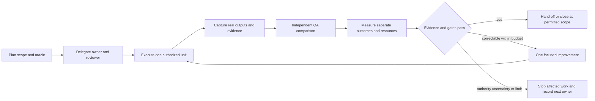

# LINE capability adaptation and agent work plan

This package adapts the supplied reference to the inspected Neurohands code. It
provides the feature/code/asset map, roles, scoped skill, tracker, test campaign
and an offline receipt scorecard. The **95–99% figures are targets**, not results.
No customer agent, provider, global plugin, database or live channel was changed.

## Source and architecture decision

Application baseline: `72f7e5f40a9a1e9930d9d099efb891f306bcffa2`; recorded deployed
reference: `889c8a4dd86c5dd615e60bc3f0a9e5b428851acf`. Both are distinct from the
alternate local workspace described in the attachment. Matching package version
3.10.0 does not mean matching code. Preserve the existing Node/Express gateway,
JavaScript agent runtime, SQL data contracts and reviewed access boundaries.
Use Python for the engineering tracker/measurement tool in this package.

The attachment combines consolidation, SDK/plugin, dashboard, workflow and LINE
claims. Its reported suite scores were not reproduced. A locally present SDK
distribution metadata file establishes metadata, not successful authenticated
operation. Google documents the [Antigravity SDK](https://antigravity.google/docs/sdk/overview)
as a Python agent harness; [PStack upstream](https://github.com/cursor/plugins/tree/main/pstack)
is an engineering workflow plugin. An optional engineering pilot can evaluate
them separately. Loading instructions does not train a model or equip Jarvis.

The six supplied figures are private reference diagrams/dashboard screenshots,
not ready-to-upload LINE menu artwork. Raw DOCX text/images stay in the ignored
intake folder. The reference file SHA-256 is
`a3a34e74ee3d393386305d491a984f81755ce278e2fe25eb8b791d716e39a711`.
Paragraph locators and image hashes are retained in the maps without copying
private screenshots or installing the document's global rules.

## Read and assign work

1. [Integration map](INTEGRATION_MAP.md): which code, instruction, SQL and asset
   contract changes belong together; distinguish implemented, proposed and unverified.
2. [Roles and tools](ROLES.md): responsibility, permitted scope, skill routing and
   actual engineering-tool availability versus missing runtime adapters.
3. [Tracker](TRACKER.json), with a [readable task list](TASKS.md): 27 capabilities, seven role cards, eleven dependency-ordered
   work items and 60 proposed discovery cases. This is an engineering plan, not a
   new status system for customer agent runs.
4. [Measurement](MEASUREMENT.md): separate compatibility, task acceptance and
   efficiency; critical failures cannot be hidden in an average.
5. [Scoped skill](skills/line-adaptation/SKILL.md): reusable instructions for this
   work. Read it explicitly when using the package in another LLM; it is not
   globally installed or automatically loaded by the production gateway.

Three independent engineering agents were actually delegated source research,
code/asset mapping and evaluation design in this session. The seven role cards
are the operating design; they do not imply seven deployed LINE agents.

## The bounded working loop



Use at most two implementation attempts per work item and one improvement cycle
per frozen campaign. Do not repeatedly probe an unchanged blocker or blindly
retry a possible external effect. Continue independent authorized work when useful.
Use the [existing process README](../PROCESS_README.md) for the actual application
commands and retain its admission, privacy, deployment and data controls.

## First implementation priorities

- **LA-04:** reproduce the exact baseline's empty-final/slow-delivery behavior,
  review shared-versus-private catalog ownership, and test truthful extraction.
  Static differences are risks to investigate; they are not proof of live leakage.
- **LA-05/06:** after P0 evidence, add typed outbound media/controls and explicit
  authorized inbound media/storage. Keep each tool small, scoped and testable.
- **LA-07:** choose a calendar/booking backend and account/scopes. No documented
  Messaging API native album/Calendar CRUD route was found. Use a separately
  approved calendar adapter or gallery; do not automate the login screen.
- **LA-08:** bind validated published definitions to an approved runtime registry
  before claiming Studio can deploy agents. It currently reports disconnected.
- **LA-09/10:** execute the frozen discovery campaign, compare matched baseline
  resources, review the evidence, then request any particular pilot/release action.

## Check this package and obtain the current scorecard

From this repository checkout, with Python 3.11 or newer:

```text
python -B -m unittest discover -s scripts/tests -p test_line_adaptation.py -v
python -B scripts/measure-line-adaptation.py --output outputs/line-adaptation-scorecard.json
```

The first command tests the receipt/measurement safeguards. The second validates
the plan and reports **NOT_RUN/null** behavioral metrics until real receipts exist.
Neither command exercises LINE, a model, calendar, storage or a customer workflow.
Record its command/exit/output and exact revision; do not label these unit tests
as the 60-case agent benchmark or 95–99% compatibility.

The [local verification receipt](references/LOCAL_VERIFICATION.json) and
[independent review history](references/HARNESS_REVIEW.md) record 17 passing
offline safeguard tests and the six false-pass paths corrected during review.
They certify only the stated structural behavior of this planning helper.

For a future frozen campaign, pass `--results <receipt.json> --evidence-root
<approved-evidence-folder>`. Receipts need campaign/revision/environment, unique
case IDs, outcomes, independent producer/reviewer identities and hashed evidence.
The scorecard validates declarations and evidence files; it does not authenticate
people or itself enforce tool permissions. Operator review remains necessary.

## Follow up

Assign the next item with objective, exact revision, allowed files/actions,
dependencies, expected oracle, owner/reviewer, budget and rollback reference.
Preserve every failed attempt and handoff. Update task state with the actual
evidence level, not the author's claimed percentage. Append dated Notion records
on requested updates and read them back. PR21 and all existing production/Sineid
holds remain in force; this package adds no deployment or account approval.
